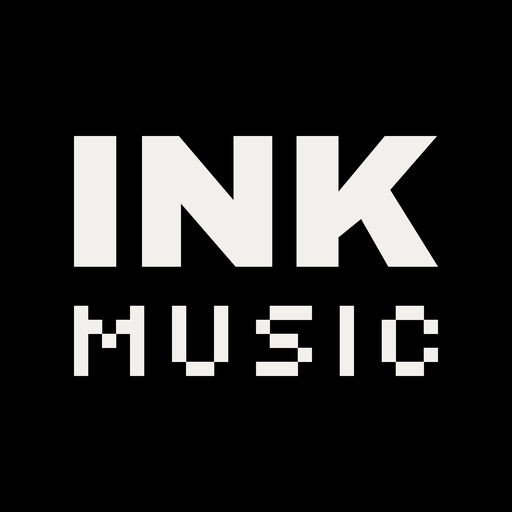
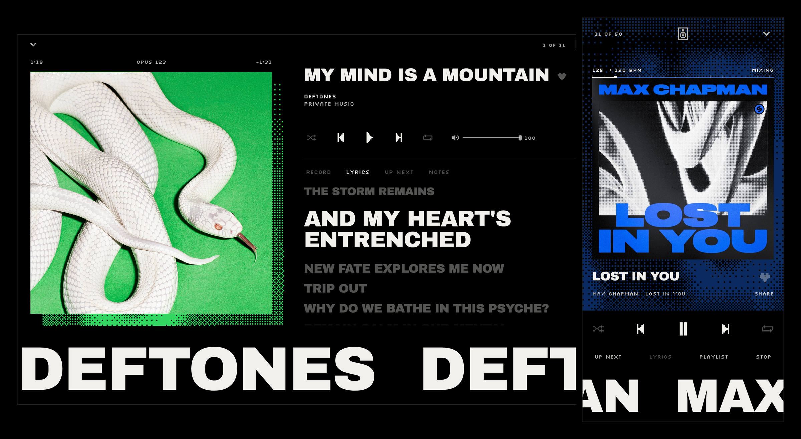
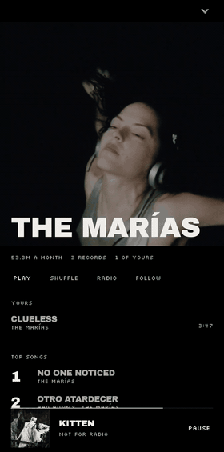
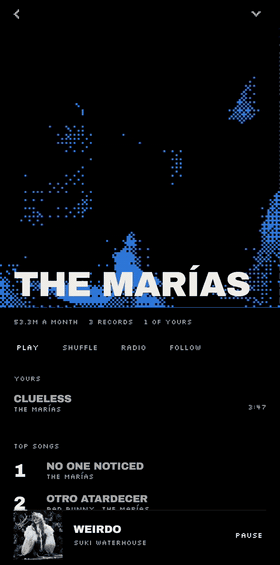
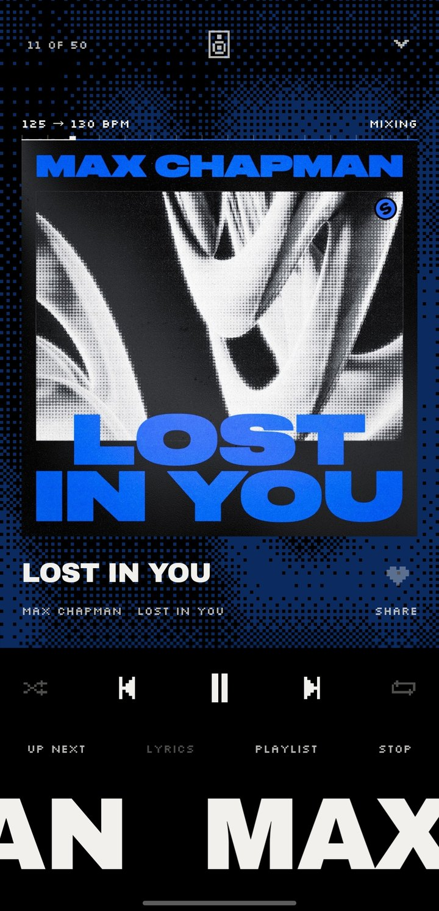
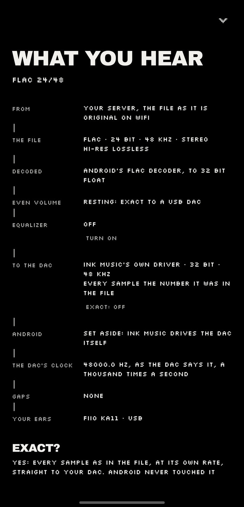
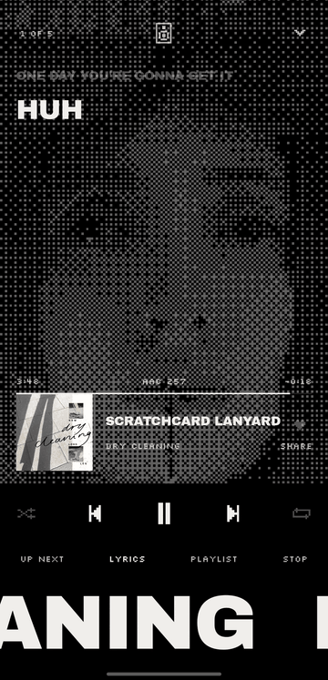
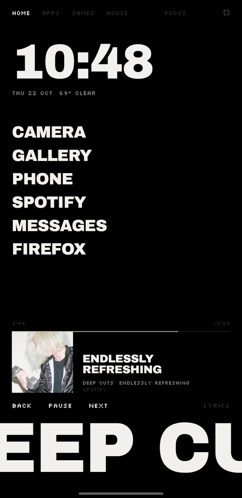

<p align="center">
  
</p>

<h1 align="center">ink music</h1>

<p align="center">
  A music player that looks like nothing else. Free and open source, for Android, Mac, Windows and Linux.<br />
  Your files, your server, YouTube Music and independent radio; new music picked by people, not a feed.
</p>

<p align="center">
  <a href="https://github.com/inkappdev/ink-music/releases/latest"></a>
  <a href="LICENSE"></a>
  
  
  
</p>

<p align="center">
  <a href="https://github.com/inkappdev/ink-music/releases/latest"></a>
  &nbsp;
  <a href="https://github.com/inkappdev/ink-music/releases/latest"></a>
  &nbsp;
  <a href="https://github.com/inkappdev/ink-music/releases/latest"></a>
  &nbsp;
  <a href="https://github.com/inkappdev/ink-music/releases/latest"></a>
  &nbsp;
  <a href="https://apps.obtainium.imranr.dev/redirect?r=obtainium://add/https://github.com/inkappdev/ink-music"></a>
</p>

<p align="center">
  
</p>

---

## Artist pages that move

<p align="center">
  
  &nbsp;&nbsp;
  
</p>

An artist's page opens on their own moving photo where Apple Music has one: as it is, or in the dither, in their
own color. New in 2.1.11, with songs you share getting a page of their own and pull down to find anything.

## New in 2.1

<p align="center">
  
  
  
</p>

- **Automix.** Songs run into each other, measured from each one. Where both beats are clear, the tempos and
  beats are matched and the bass handed across halfway; the progress line turns into a crossfader.
- **Bit-perfect to your USB DAC, on any phone.** ink music drives the DAC itself, past Android's mixer: every
  sample as in the file, at its own rate, the DAC's own volume. 24 bit kept 24 bit.
- **Podcasts** on phone and computer, your place kept on both; offline and skip silence on the phone.
- **Lyrics word by word**: drag to read them all, tap a line to play from there.
- **The right YouTube version** of a song, and **an equalizer in two layers**: your headphones, a shape on top.

Every version's changes are in [the releases](https://github.com/inkappdev/ink-music/releases).
Want something? [Ask for it](https://github.com/inkappdev/ink-music/issues), or come say hi at
[r/inkmusic](https://www.reddit.com/r/inkmusic/).

## What you hear

Tap the format over any cover and ink music shows the sound's whole way to your ears: the file, the decoder,
even volume and the equalizer, what Android does to it, and where it plays. Casting, it asks the receiver itself:
a Denon in Direct says so, and the page says **exact: yes**. On the computer, the same path as mpv plays it
(Core Audio, WASAPI, PipeWire), exclusive if you like.

## Your music, from wherever it lives

| | |
|---|---|
| **The phone's files** | Or your computer's music folder, filed by record and artist. |
| **Your own server** | Navidrome or any Subsonic server, streamed or **kept on the phone**. Loves are its stars, playlists its playlists. |
| **YouTube Music** | Search and play without an account, through [NewPipe Extractor](https://github.com/TeamNewPipe/NewPipeExtractor). Signed in: your library both ways, uploads, and **Premium's 256 kbps**. `full` build only. |
| **Spotify playlists** | Brought in from a file ([Exportify](https://exportify.app)), each song found in your music or on YouTube Music. |
| **ink radio** | Sixty-two independent, listener-powered stations chosen by hand (KEXP, NTS, dublab, WFMU, Radio alHara...), each saying what it's playing. Thousands more from [radio-browser.info](https://www.radio-browser.info). |
| **Podcasts** | Any show from Apple's podcast directory, or any feed you paste. |

Pick a few artists you love and **listen** fills with their mixes and records, what indie radio played most this
week, and every Friday **ink weekly**, picked by real people. **INK** gathers what critics and DJs are picking.

## Features

- **The player** whole-screen over the cover, in five looks; moving covers and a song's Spotify Canvas behind.
- **Circle a thumb round the cover** to scrub, as on an iPod; flick it for the next song.
- **An equalizer** with corrections for thousands of **headphones** ([AutoEq](https://github.com/jaakkopasanen/AutoEq)), **even volume** (ReplayGain), **soft pause**.
- **Play on** Chromecast, Google Nest and DLNA (Denon HEOS and others), the original hi-res file where the speaker takes it. No Google Play services needed.
- **Your phone and computer in step** over your wifi: what you've heard, loves, sign-ins, and **continue here**.
- **Radio** when the queue runs out; **a path** from one song to another with [AudioMuse-AI](https://github.com/NeptuneHub/AudioMuse-AI).
- **Made for you**, from your listening only; **your year**, any day of it, shared as a poster.
- **Android Auto**, a **widget**, a **mini player** on the computer, Now Playing and media keys on a Mac.
- **Scrobbling** to [ListenBrainz](https://listenbrainz.org) and Last.fm; **private listening** when you'd rather not.

## Download

Everything is on the [GitHub releases](https://github.com/inkappdev/ink-music/releases), signed, with
SHA-256 sums.

**Android 12 or later.** [Obtainium](https://github.com/ImranR98/Obtainium) keeps it up to date, and the
`full` build updates itself. F-Droid is next. The `full` apks from releases have Last.fm; a build from
source needs its own key.

| Build | Sources | Where |
|---|---|---|
| `ink-music-<version>.apk` (`full`) | Files, your server, YouTube Music, radio | GitHub releases, Obtainium |
| `ink-music-<version>-play.apk` (`play`) | Files, your server, radio. No NewPipe code at all | The only build that may go to Google Play |

The release certificate's SHA-256:
`92eb2c4ea8d70b897db7cf000356f72cc2f3e698c39bb31f4b62ba717747e663`
(check with `apksigner verify --print-certs`, or paste into [AppVerifier](https://github.com/soupslurpr/AppVerifier):
`app.ink.music` and
`92:EB:2C:4E:A8:D7:0B:89:7D:B7:CF:00:03:56:F7:2C:C2:F3:E6:98:C3:9B:B3:1F:4B:62:BA:71:77:47:E6:63`).

**Mac** (Apple silicon): the `.dmg`. It isn't signed by Apple yet, so the first time, macOS stops it:
System Settings, Privacy & Security, **Open Anyway**.

**Windows**: the `.msi`, installed just for you, no administrator needed. Windows SmartScreen
doesn't know it yet: **More info**, then **Run anyway**. To pair your phone, Windows' firewall has to let
it in: ink music asks, in settings under your phone.

**Linux**: the `.deb` (Debian, Ubuntu) or `.rpm` (Fedora). It plays through your system's libmpv
(`libmpv2` on Debian and Ubuntu, `mpv-libs` on Fedora).

## Privacy

No ads, no accounts, no analytics, no tracking. What you've played stays on your own devices. Nothing leaves
them except to your own server, your other devices on your own wifi, and the services that answer what you ask for.

<details>
<summary>Every service, what it receives, and why</summary>

| Service | What it receives | Why |
|---|---|---|
| Your Navidrome / Subsonic server | Sign-in (a salted token, never the password), plays, stars | Your library |
| [lrclib.net](https://lrclib.net) | A song's artist and title | Lyrics |
| [Better Lyrics](https://betterlyrics.org)' server | A song's artist, title and length | Lyrics timed word by word |
| Apple's podcast directory | What you search for | Finding shows, the most listened to |
| The shows' own feeds and hosts | Nothing personal | Podcasts' episodes |
| YouTube Music (`full` build) | Your searches, the artists you pick; signed in, your sign-in and the songs you play (your history there, off in settings) | Search, mixes, radio, your library |
| [ListenBrainz](https://listenbrainz.org) / Last.fm, if you connect them | What you play | Scrobbling |
| [AutoEq](https://github.com/jaakkopasanen/AutoEq) on GitHub | Nothing personal, when you look up your headphones | Their tuning |
| [radio-browser.info](https://www.radio-browser.info) | Nothing personal | The station list |
| The stations' own playlists | Nothing personal | The indie chart, what's on air |
| Your paired phone or computer, on your wifi | What you've heard, loves, sign-ins (Spotify's an hour's pass), what's playing, sealed with a key only the two of them have | Keeping them in step |
| Apple Music's catalog | A record's artist and title | Moving covers |
| Spotify, if you sign in (`full` build) | Your sign-in, a song's artist and title; your playlists when you import one | The Canvas behind a song, importing playlists |
| Publications' and stations' own feeds (Pitchfork, Bandcamp Daily, NPR and others) | Nothing personal | INK's picks |
| iTunes, Deezer and YouTube Music | A record's artist and title | Covers where your files have none |
| [Last.fm](https://www.last.fm)'s tags | Nothing personal | INK's moods |
| GitHub | Nothing personal, every six hours (`full` build and computers) | Whether there's a new version |

</details>

## From the makers of ink

<p align="center">
  
</p>

ink music comes from **[ink](https://inkhome.app)**, a typographic home screen for Android phones and TVs in the
same look: your apps as big words, five seconds before instagram opens, your games as a console, your house as
words. In a free test on Google Play now: **[join the test](https://inkhome.app/test/)**.

## How it's made

Built with Claude (Anthropic's AI) as a coding partner: the design, the decisions and the testing are done by
hand. Every feature is tried on a real phone and computer before it ships, and ink weekly is picked by hand.

Issues and pull requests are welcome. For anything visible, open an issue first: ink music has a strong look
(black, two typefaces, no icons where a word works), and we'll talk it through.

<details>
<summary>Building</summary>

JDK 21. The phone also needs the Android SDK (API 37); the computer's app needs a libmpv to play.

```sh
./gradlew :app:assembleFullDebug      # the phone: a debug build
./gradlew :app:assembleFullRelease    # the phone: a release build (R8)
tools/release.sh                      # both phone builds, signed, with SHA256SUMS, in build/release/

./gradlew :desktop:run -PdesktopOnly  # the computer's app, without the Android SDK
```

The computer's installers are each made on their own system (`.github/workflows/`): the Mac's `.dmg`
on macOS, the `.msi` on Windows (`:desktop:packageInkMsi`, ink's own installer pages), the `.deb` and
`.rpm` on Linux.

Release builds are signed with the key named in `keystore.properties` beside `settings.gradle.kts`
(`storeFile`, `storePassword`, `keyAlias`, `keyPassword`; never committed). Without it they're
signed with the debug key. Each release raises `versionCode` and `versionName` in
`app/build.gradle.kts` and adds `fastlane/metadata/android/en-US/changelogs/<versionCode>.txt`.

The icon and store graphics are drawn from the bundled fonts: `python3 tools/make-icon.py`
(fontTools, Pillow).

Built with Kotlin and Jetpack Compose, [Media3](https://github.com/androidx/media) (ExoPlayer and a
MediaLibrarySession in its own process) and [Haze](https://github.com/chrisbanes/haze) on the phone;
[Compose Multiplatform](https://www.jetbrains.com/compose-multiplatform/) and [mpv](https://mpv.io) on
the computer, with what the two share in `core/`.

</details>

<details>
<summary>Thanks</summary>

- [NewPipe Extractor](https://github.com/TeamNewPipe/NewPipeExtractor) (GPL-3.0), and the poToken
  provider from [NewPipe](https://github.com/TeamNewPipe/NewPipe) (GPL-3.0), ported.
- [Metrolist](https://github.com/mostafaalagamy/Metrolist) (GPL-3.0), for showing how YouTube Music
  can be done well on Android.
- [yt-dlp's challenge solver](https://github.com/yt-dlp/ejs) (Unlicense, with meriyah and astring), which
  works out a signed-in stream's link from YouTube's own player.
- [Prism](https://github.com/Yigder/Prism) (GPL-3.0), whose tempo reading automix's beat matching is
  adapted from.
- [FireTheDJ](https://github.com/suryablaze02-byte/FireTheDJ) (GPL-3.0), whose bar, key and filter-fade ideas
  automix's handovers are adapted from.
- [AutoEq](https://github.com/jaakkopasanen/AutoEq) (MIT), for the headphone tunings, from measurements by
  oratory1990, crinacle, Rtings and others.
- [Media3](https://github.com/androidx/media) and [Haze](https://github.com/chrisbanes/haze) (Apache-2.0).
- On the computer: [mpv](https://mpv.io) (LGPL-2.1+, its Windows builds from
  [shinchiro](https://github.com/shinchiro/mpv-winbuild-cmake)), [Compose Multiplatform](https://github.com/JetBrains/compose-multiplatform)
  (Apache-2.0), [JNA](https://github.com/java-native-access/jna) (Apache-2.0), [JmDNS](https://github.com/jmdns/jmdns)
  (Apache-2.0) and [jaudiotagger](https://bitbucket.org/ijabz/jaudiotagger) (LGPL-2.1).
- Archivo Black and Silkscreen, both under the SIL Open Font License.
- INK's picks from the publications and DJs who make them: Pitchfork, Stereogum, Bandcamp Daily, NPR,
  NME, the Quietus, Aquarium Drunkard, Gorilla vs. Bear, Dusted, Stereofox, The FADER and more. Go read them.
- [Meld](https://github.com/FrancescoGrazioso/Meld) (GPL-3.0), for the ideas of choosing a song's YouTube version and
  skipping a podcast's silence.
- Lyrics from [lrclib.net](https://lrclib.net), [Better Lyrics](https://betterlyrics.org) and YouTube Music; stations from
  [radio-browser.info](https://www.radio-browser.info) and the stations themselves; scrobbling to
  [ListenBrainz](https://listenbrainz.org) and [Last.fm](https://www.last.fm).

</details>

## Not affiliated

ink music is not affiliated with, funded, authorized or endorsed by YouTube, Google LLC, Spotify,
Apple, Microsoft, Navidrome, any publication or any radio station. Trademarks belong to their owners.

## License

[GPL-3.0](LICENSE). Free, always: no paywall, ever.

<p align="center"><sub>From the makers of <a href="https://inkhome.app"><b>ink</b></a>, a home screen for Android phones and TVs.</sub></p>
