<p align="center">
  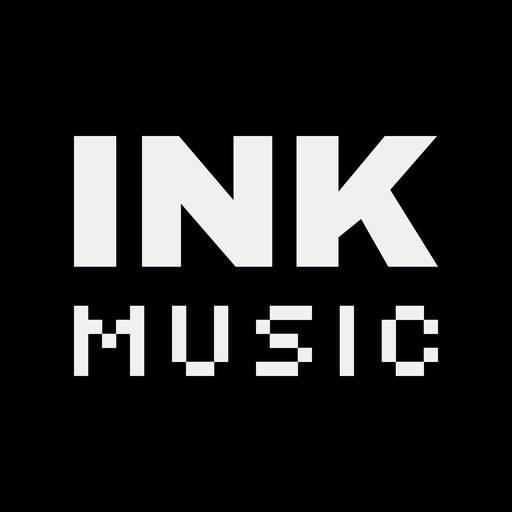
</p>

<h1 align="center">ink music</h1>

<p align="center">
  A free, open-source music player for Android.<br />
  Pure black, warm white type, no chrome: the album art is the only colour on screen.
</p>

<p align="center">
  <a href="https://github.com/inkappdev/ink-music/releases/latest"></a>
  <a href="LICENSE"></a>
  
  
</p>

<p align="center">
  <a href="https://github.com/inkappdev/ink-music/releases/latest"></a>
  &nbsp;
  <a href="https://apps.obtainium.imranr.dev/redirect?r=obtainium://add/https://github.com/inkappdev/ink-music"></a>
</p>

<p align="center">
  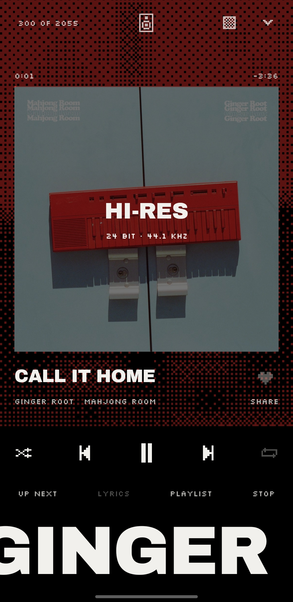
  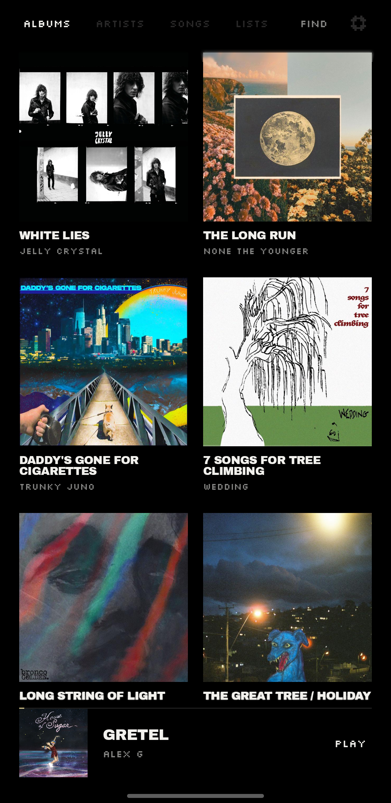
  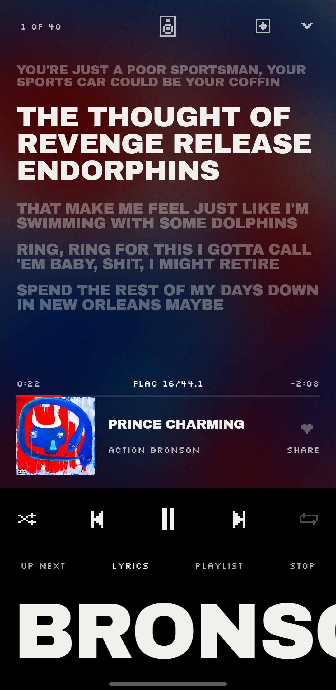
  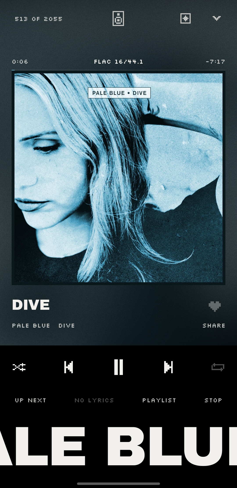
</p>
<p align="center">
  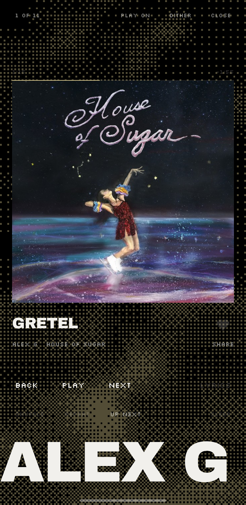
  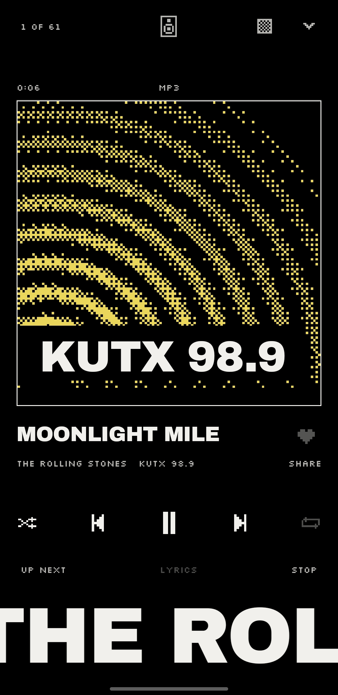
  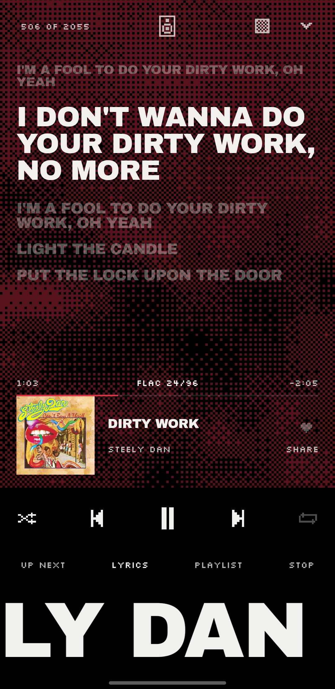
  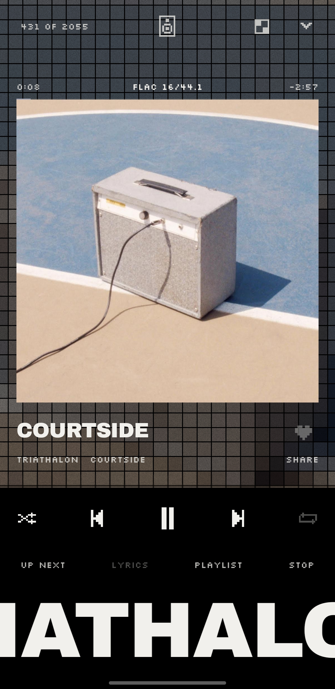
</p>

---

## Your music, from wherever it lives

| | |
|---|---|
| **The phone's files** | Everything in its music folder, filed by record and artist, with the covers your files carry. |
| **Your own server** | Navidrome or any Subsonic server: your whole library streamed from home. Loves are the server's stars and playlists are its playlists, so every app you use agrees. |
| **YouTube Music** | Search songs and records and play them, through [NewPipe Extractor](https://github.com/TeamNewPipe/NewPipeExtractor). No account. `full` build only. |
| **ink radio** | Independent, listener-powered stations chosen by hand, each saying what it's playing ([below](#ink-radio)). |

## ink radio

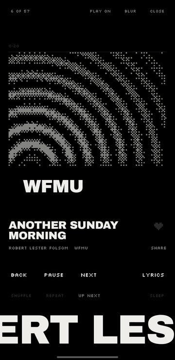

Fifty-seven independent, listener-powered and community stations, chosen by hand: KEXP in
Seattle, NTS in London, dublab in Los Angeles, WFMU in Jersey City, Radio alHara in Bethlehem,
and on round the world.

Each says what it's playing, from its stream or its own playlist, on the player, the lock screen,
the widget and the car. Where a station gives the record's cover, you see it; where it doesn't,
its name sends out rings in 1-bit dither, moving while it plays.

Thousands more by genre from [radio-browser.info](https://www.radio-browser.info).

<br clear="right" />

## Something to play the moment it opens

Pick a few artists you love and the **listen** page fills with their mixes and records, the songs
indie radio played most this week (KEXP, KCRW and WXPN, counted), ink radio, and what you played
lately. Even with nothing on the phone.

## Features

**The player**
- Whole-screen over the cover, in five looks: blur, fluted glass, pixels, dither, plain.
- Circle a thumb round the cover to scrub, as on an iPod.
- Synced lyrics from [lrclib](https://lrclib.net), with the cover small beside them.
- **Even volume** (ReplayGain) from the files' own tags or the server's. A record played through keeps its own quiet and loud.

**Listening**
- **Radio**: when the queue runs out, more like it. Your server's similar songs first, then YouTube Music's mix.
- **Playlists** made and changed here, kept on your server.
- A sleep timer that eases the music out, shuffle and repeat, and an up next you can reorder.
- The library shuffled anew each time you open it, if you like.

**Everywhere else**
- **Play on** Chromecast speakers and TVs, speaker groups and DLNA receivers (Denon HEOS and others), sending the original hi-res file where the speaker can take it. No Google Play services needed.
- **Android Auto**: records, artists, lists, search, and "play … on ink music".
- A **home-screen widget**, the mini player in ink's look.

**Yours**
- **Your year**, any day of it: the minutes, and the songs, artists and records you played most.
- **Share** a song or your year as a poster sized for a story.

## Privacy

No ads, no accounts, no analytics, no tracking. Nothing of yours leaves the phone except to your
own server, and to the services that answer what you ask for:

| Service | What it receives | Why |
|---|---|---|
| Your Navidrome / Subsonic server | Sign-in (a salted token, never the password), plays, stars | Your library |
| [lrclib.net](https://lrclib.net) | A song's artist and title | Lyrics |
| YouTube Music (`full` build) | Your searches, the artists you pick | Search, mixes, radio |
| [radio-browser.info](https://www.radio-browser.info) | Nothing personal | The station list |
| The stations' own playlists | Nothing personal | The indie chart, what's on air |

What you've played is kept on the phone only.

## Download

Signed APKs are attached to every [GitHub release](https://github.com/inkappdev/ink-music/releases),
with their SHA-256 sums. [Obtainium](https://github.com/ImranR98/Obtainium) keeps it up to date.
IzzyOnDroid is next.

| Build | Sources | Where |
|---|---|---|
| `ink-music-<version>.apk` (`full`) | Files, your server, YouTube Music, radio | GitHub releases, Obtainium, IzzyOnDroid |
| `ink-music-<version>-play.apk` (`play`) | Files, your server, radio. No NewPipe code at all | The only build that may go to Google Play |

The release certificate's SHA-256:
`92eb2c4ea8d70b897db7cf000356f72cc2f3e698c39bb31f4b62ba717747e663`
(check with `apksigner verify --print-certs`).

Android 12 or later.

## From the makers of ink

<p align="center">
  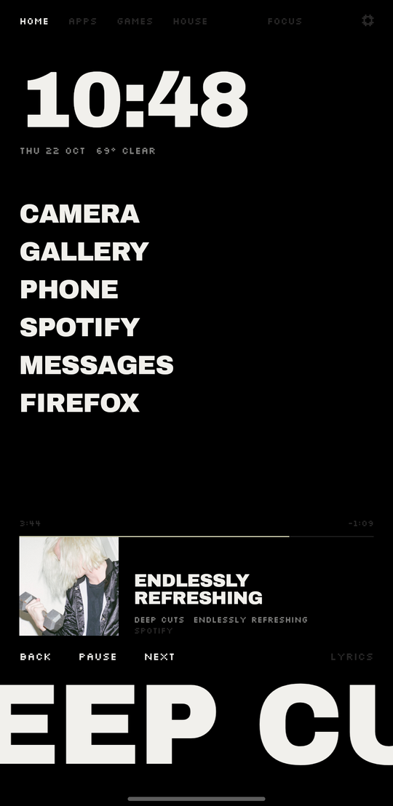
  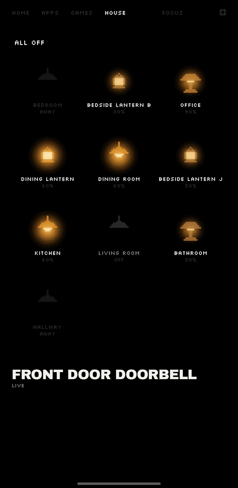
  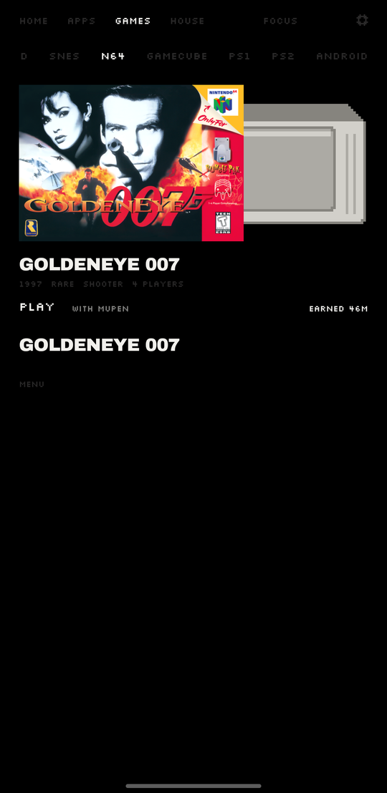
  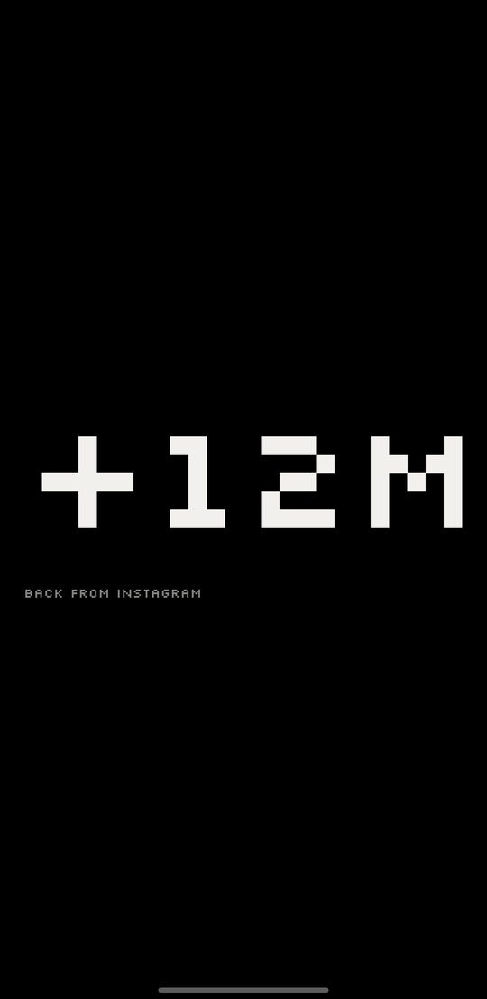
</p>
<p align="center">
  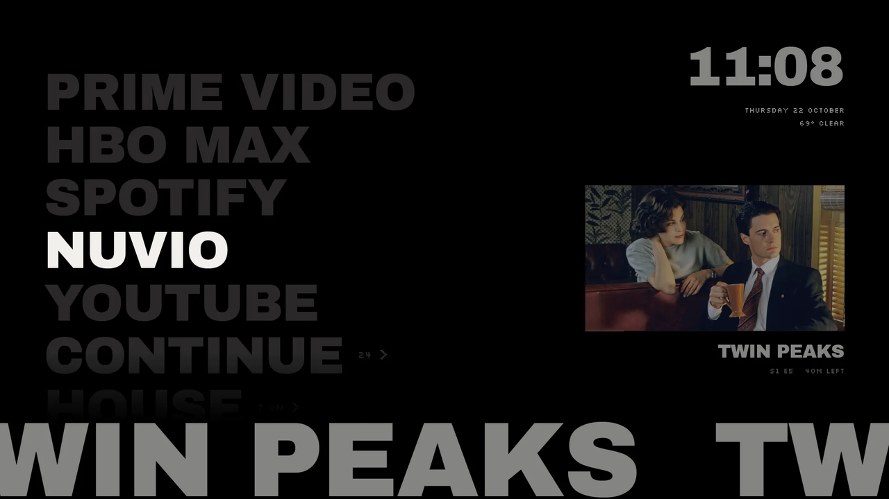
</p>

ink music is the music player from **[ink](https://inkhome.app)**, a typographic home screen for
Android phones and TVs, in the same look. Your apps as big words, the song playing along the
bottom from any player, and your time back from the feed:

- **Five seconds first.** Open instagram and ink waits: its name, how many times today, a line
  filling slowly. Then open it, or not now. Daily limits and focus when you want them.
- **Your phone as a console.** Point it at your games folder: box art, shelves, time played, each
  system opened in its emulator.
- **Your house as words.** With Home Assistant, every light a little pixel lamp; your scenes,
  cameras and doorbell.
- **ink tv.** The same ink on your TV, and from your phone it turns off the TV's ads and tracking
  over your wifi. "Put it back" undoes exactly what changed.

No accounts, no ads, no analytics. ink is in a free test on Google Play now, everything open:
**[join the test](https://inkhome.app/test/)** · [inkhome.app](https://inkhome.app)

## Building

JDK 21 and the Android SDK (API 37).

```sh
./gradlew :app:assembleFullDebug      # a debug build
./gradlew :app:assembleFullRelease    # a release build (R8)
tools/release.sh                      # both builds, signed, with SHA256SUMS, in build/release/
```

Release builds are signed with the key named in `keystore.properties` beside `settings.gradle.kts`
(`storeFile`, `storePassword`, `keyAlias`, `keyPassword`; never committed). Without it they're
signed with the debug key. Each release raises `versionCode` and `versionName` in
`app/build.gradle.kts` and adds `fastlane/metadata/android/en-US/changelogs/<versionCode>.txt`.

The icon and store graphics are drawn from the bundled fonts: `python3 tools/make-icon.py`
(fontTools, Pillow).

Built with Kotlin and Jetpack Compose, [Media3](https://github.com/androidx/media) (ExoPlayer and a
MediaLibrarySession in its own process) and [Haze](https://github.com/chrisbanes/haze).

## Contributing

Issues and pull requests are welcome. ink music has a strong look (black, two typefaces, no icons
where a word works, no rounded corners), so for anything visible, open an issue first and we'll
talk it through.

## Thanks

- [NewPipe Extractor](https://github.com/TeamNewPipe/NewPipeExtractor) (GPL-3.0), and the poToken
  provider from [NewPipe](https://github.com/TeamNewPipe/NewPipe) (GPL-3.0), ported.
- [Metrolist](https://github.com/mostafaalagamy/Metrolist) (GPL-3.0), for showing how YouTube Music
  can be done well on Android.
- [Media3](https://github.com/androidx/media) and [Haze](https://github.com/chrisbanes/haze) (Apache-2.0).
- Archivo Black and Silkscreen, both under the SIL Open Font License.
- Lyrics from [lrclib.net](https://lrclib.net); stations from
  [radio-browser.info](https://www.radio-browser.info) and the stations themselves.

## Not affiliated

ink music is not affiliated with, funded, authorized or endorsed by YouTube, Google LLC, Spotify,
Navidrome or any radio station. Trademarks belong to their owners.

## License

[GPL-3.0](LICENSE). Free, always: no paywall, ever.

<p align="center"><sub>From the makers of <a href="https://inkhome.app"><b>ink</b></a>, a home screen for Android phones and TVs.</sub></p>
